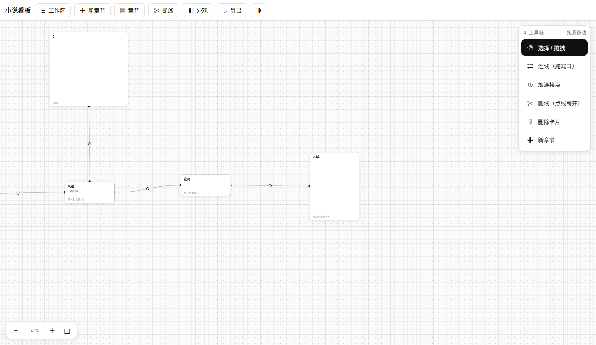
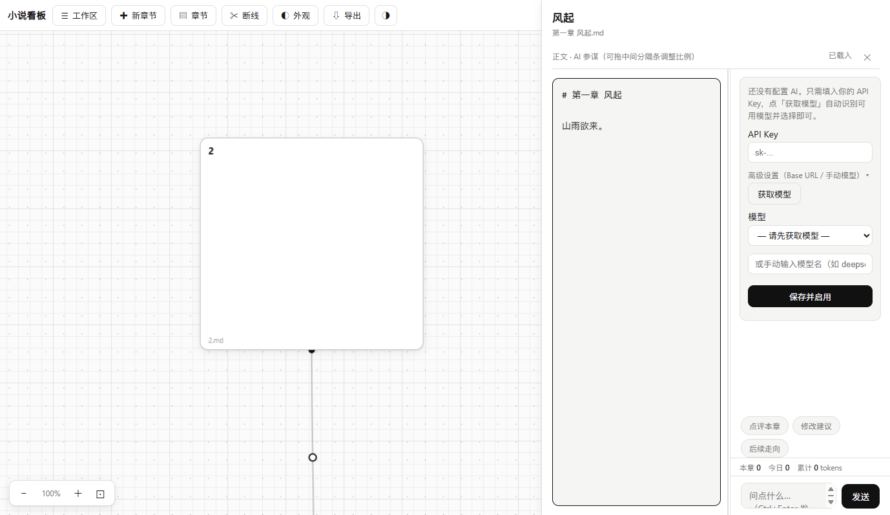
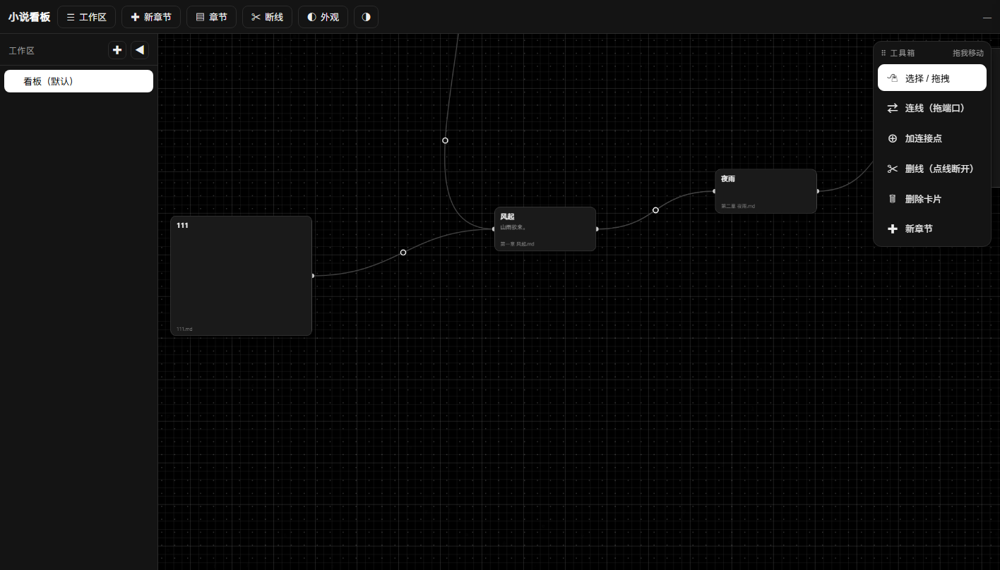
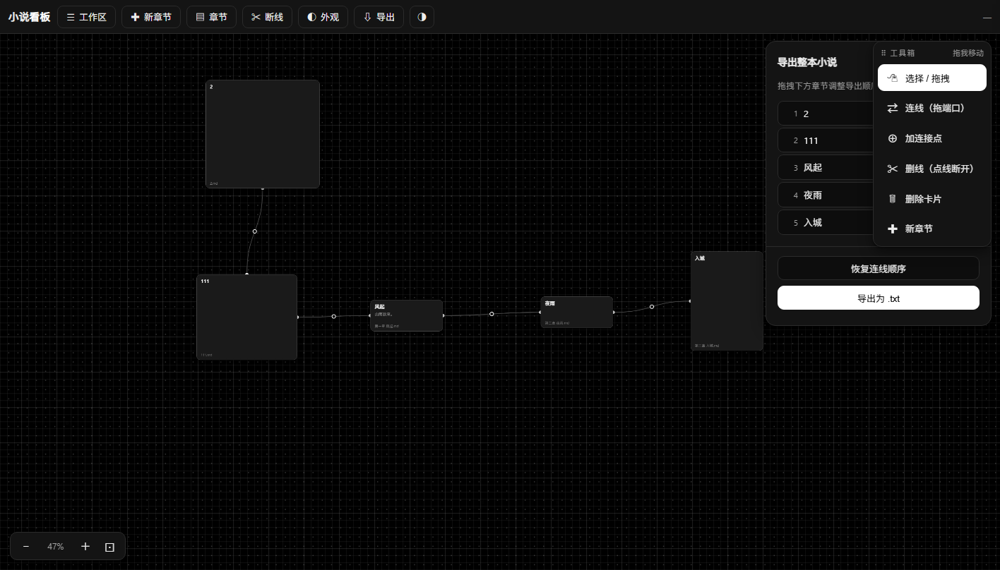

# 小说看板 · Novel Board

一个给长篇小说作者用的**结构看板 + 写作工作台**：横向时间树管理章节关系，点卡片写正文，右侧 AI 参谋陪聊，一键把连线流导出成整本书。提供**在线网页版**（免安装）、本地浏览器版与 Windows 桌面版。





## 在线使用（无需安装）

👉 **https://lovemovexurong.github.io/novel-board/**

纯静态网页版：数据（章节、看板、AI 配置、会话）全部保存在你自己的浏览器 localStorage，不经过任何服务器；AI 调用由浏览器直连你填的 OpenAI 兼容端点。换设备数据不跟随，适合轻量试用的作者。

## 功能

- **多工作区**：每本小说一个独立看板，支持子工作区，左侧树切换
- **横向时间树**：卡片自由拖拽/缩放，四边端口连线（可任意增删端口、拖拽调位置），连线强锚定卡片，拖动不跑偏
- **悬浮工具箱**：选择 / 连线 / 加连接点 / 删线 / **删除卡片** / 新章节
- **写作抽屉**：正文与 AI 参谋**左右分栏**同时可见，Ctrl+S 写回原 `.md` 文件
- **AI 参谋**：只需填一个 API Key 点「获取模型」即可用（OpenAI 兼容端点），每章独立会话 + 跨章共享摘要自动维护
- **Token 用量统计**：本章 / 今日 / 累计 tokens 实时显示
- **整本导出**：按连线顺序（可拖拽调整）把所有章节正文合并导出为 `.txt`，写完即出书稿
- **视觉**：纯黑白灰、无渐变；深浅双主题；点阵/浓度/节点尺寸可调
- **数据安全**：状态原子写 + 自动备份（保留 60 份）+ hash 冲突检测
- **桌面端**：Electron，单实例、托盘、窗口记忆、书稿目录可选、API Key 走系统加密存储





## 下载

Windows 桌面版安装包见 [Releases](https://github.com/lovemovexurong/novel-board/releases)（`小说看板-<版本>-x64.exe`，per-user 安装，免管理员）。

## 本地浏览器版

```bash
cd board
node server.mjs          # http://127.0.0.1:4317/
```

章节 `.md` 放在 `board/chapters/`（或自选工作区目录），看板状态存 `board/.board-state.json`。

## 桌面版（Windows 11）

```bash
cd desktop
npm install
npm run dev:browser      # 浏览器开发模式
npm run dev              # Electron 开发模式
npm run build            # 产出 dist/小说看板-<ver>-x64.exe（NSIS，per-user 免管理员）
```

详见 `desktop/README-构建.md`。

## 操作速查

| 操作 | 方式 |
|---|---|
| 打开编辑 | 单击卡片任意位置 |
| 移动卡片 | 按住拖动 |
| 连线 | 工具箱「连线」→ 依次点两个端口；或直接拖端口 |
| 加连接点 | 工具箱「加连接点」→ 点卡片边缘 |
| 端口挪位置 | Alt + 拖动端口 |
| 删端口 | 右键端口（挂在上面的线一并清理） |
| 删线 | 工具箱「删线」→ 点线 |
| 删除卡片 | 工具箱「删除卡片」→ 点卡片（可选是否删章节文件） |
| 保存正文 | Ctrl+S |
| 导出整本 | 顶栏「导出」→ 拖拽排序 → 导出 txt |
| 缩放/平移 | 滚轮 / 中键拖动 |

## 技术

- 前端：原生 JS + Canvas（ASCII 背景），单文件 `index.html`
- 网页版：纯静态部署（GitHub Pages），localStorage 数据层，AI 前端直连
- 服务：Node 零依赖 HTTP，状态/文件/AI 代理，只绑 `127.0.0.1`
- 桌面：Electron 33，主进程内嵌服务（随机端口），`safeStorage` 加密密钥

## License

MIT
